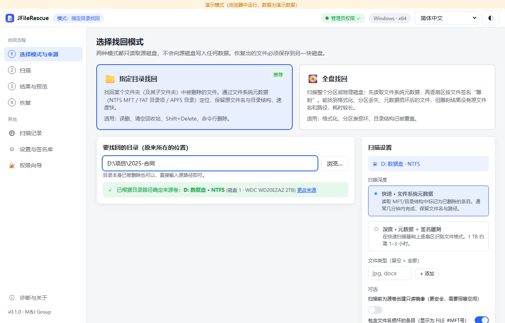
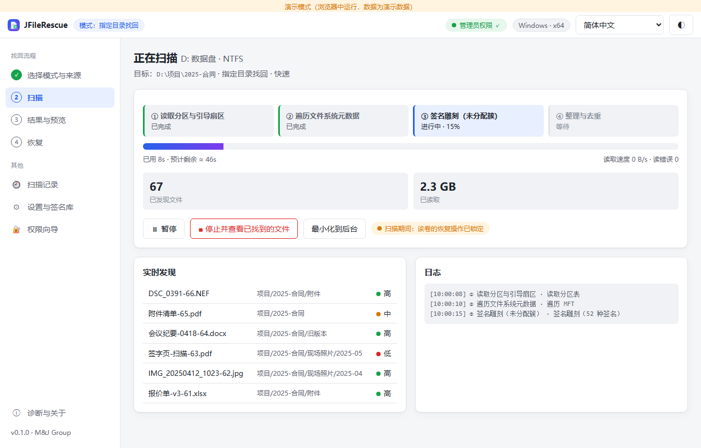
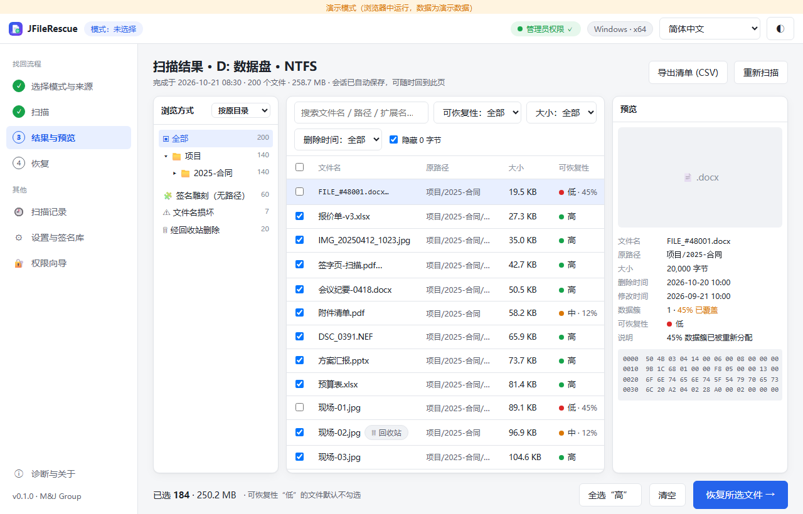
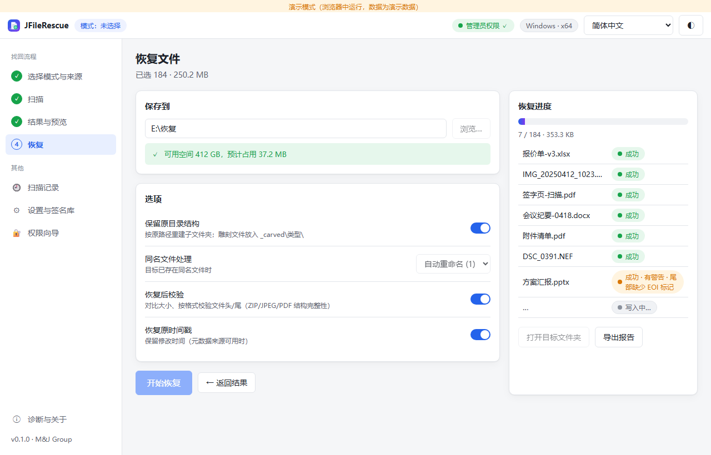
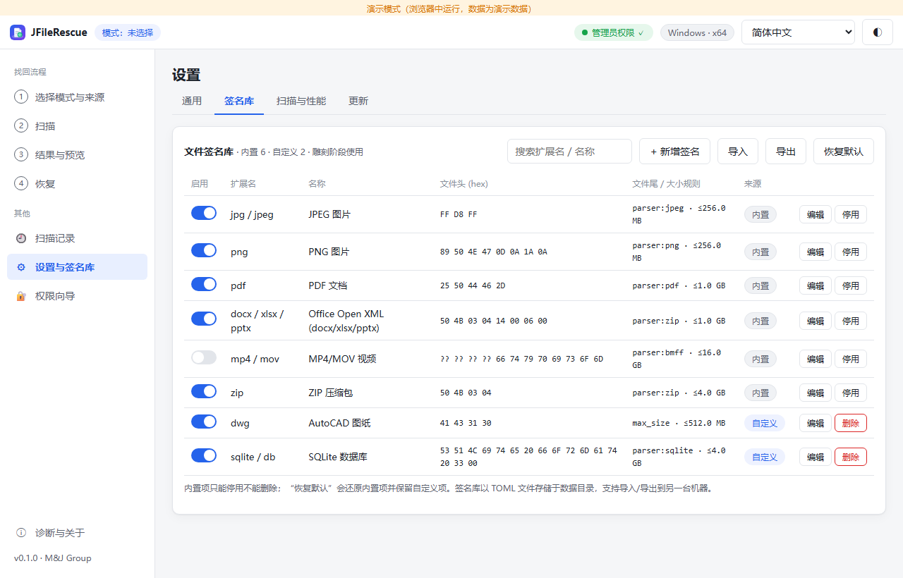
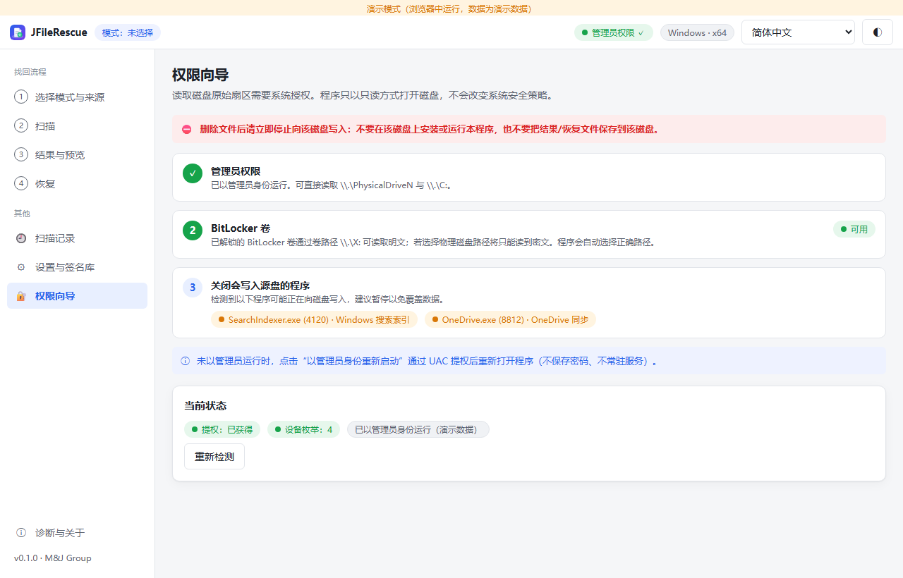
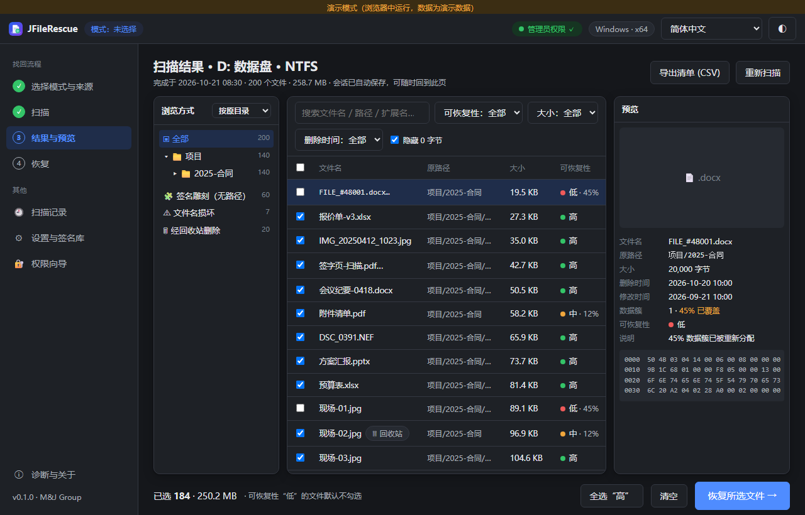
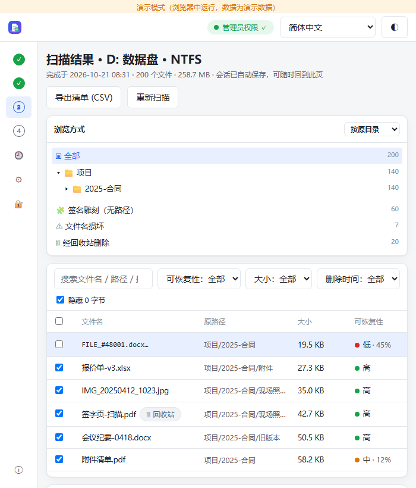

# JFileRescue

跨平台（Windows / macOS）**只读**文件找回工具。两种模式：

- **指定目录找回** — 通过文件系统元数据（NTFS MFT、FAT/exFAT 目录项、APFS 文件系统树残留节点）找回某个文件夹下被删除的文件，保留原文件名与目录结构。
- **全盘找回** — 元数据 + 按文件签名逐扇区雕刻未分配空间，可找回格式化、分区表损坏后的文件（雕刻结果无原文件名）。

源磁盘永远只读打开；恢复目标与源在同一磁盘时在 Rust 端拒绝写入。**程序自身也不向源磁盘写入**：结果存储位置与源盘相同时结果只留在内存，可在设置中把存储位置（含 WebView 缓存）改到另一块磁盘。

> 删除文件后请立即停止向该磁盘写入：不要在该磁盘上安装或运行本程序。系统盘（SSD + TRIM）上被删除的数据通常在数秒内被固件擦除。

> M&J Group · 473276@qq.com · MIT OR Apache-2.0

## 截图

| | |
| --- | --- |
|  选择模式与来源 |  扫描进度 |
|  结果、筛选与预览 |  恢复进度与校验 |
|  签名库（界面内增删改/启停/导入导出） |  权限向导 |
|  深色主题 |  窄窗口 |

## 架构

```
crates/recovery-core      纯 Rust 核心（无 GUI 依赖）：分区表、NTFS/FAT/exFAT/APFS 解析、签名雕刻、会话、恢复写出
crates/recovery-platform  设备枚举与只读打开：Windows (PhysicalDriveN / 卷句柄、BitLocker、TRIM)、macOS (diskutil / rdisk、FileVault、TCC)
crates/recovery-cli       jfr 命令行（与 GUI 共用核心；无人值守/测试）
src-tauri                 Tauri 2 后端（IPC、同盘拒绝、扫描/恢复线程、签名库持久化、updater）
src                       Vue 3 + TypeScript 前端（简中/繁中/英/日，浅/深色，浏览器演示模式）
helper/macos              macOS 特权助手（SMAppService，只读打开 /dev/rdiskN 并传回 fd）
```

能力矩阵（第一版）：

| 文件系统 | 指定目录 | 全盘·元数据 | 全盘·雕刻 |
| --- | --- | --- | --- |
| NTFS | ✅（含经回收站删除：按 `$I` 记录还原原路径） | ✅ | ✅ |
| FAT12/16/32、exFAT | ✅ | ✅ | ✅ |
| APFS 未加密 | ✅ | ✅ | ✅ |
| APFS FileVault | ⚠ 密文，不可用 | ⚠ | ❌ |
| 未知/损坏分区表 | ❌ | ❌ | ✅ |

HFS+ 不在第一版范围。无 GPL 组件；签名规则为公开格式事实，雕刻实现自有。

## 开发

需要：Rust stable、Node 20+、pnpm 9；Windows 需 VS Build Tools (C++ 工作负载)，macOS 需 Xcode CLT。

```sh
pnpm install
pnpm tauri dev                 # 开发运行
cargo test --workspace         # Rust 测试（含 FAT32 内存镜像集成测试）
pnpm typecheck && pnpm build   # 前端
pnpm tauri build               # 生产安装包（Windows: NSIS/MSI；macOS: app/dmg）
pnpm icons                     # 从 public/icon.svg 重新生成全部图标
pnpm screenshots               # Playwright 截图到 docs/screenshots/
```

真实文件系统镜像测试：`node scripts/make-test-images.mjs`（Windows 需管理员；脚本会临时关闭 TRIM 通知并在删除前 fsync，否则被删簇会被 VHD 驱动立即清零；macOS 用 hdiutil 生成 APFS/exFAT/FAT32），然后 `cargo test -p recovery-core --test images`。镜像不存在时对应测试自动跳过。`*-trimmed.img` 是故意在 TRIM 开启时生成的回归夹具。

### CLI

```sh
jfr devices                                   # 列出磁盘/卷与权限状态（需管理员/sudo）
jfr scan \\.\D: --mode directory --dir "项目\2025-合同"
jfr scan /dev/rdisk4 --mode full --depth deep --ext jpg,docx
jfr scan test-images/ntfs.img --json          # 镜像文件
jfr show <session> --query 合同 --csv out.csv
jfr recover <session> E:\恢复 --ids 1,2,3     # 目标须在另一块磁盘
jfr image \\.\PhysicalDrive1 E:\disk1.img     # 先做只读镜像
jfr sigs list | enable | disable | export | import | restore-defaults
```

## 权限

- Windows：以管理员运行（UAC），只读打开 `\\.\PhysicalDriveN` 与 `\\.\X:`；BitLocker 已解锁卷自动走卷路径读明文。
- macOS：GUI 保持普通用户，通过特权助手只读打开设备；系统盘另需「完全磁盘访问」。FileVault 卷在设备层为密文。

程序不改变任何系统安全策略，不保存密码，不常驻服务。

## 发布

`.github/workflows/release.yml`：按 tag 构建 Windows x64（NSIS + MSI，内置 WebView2 离线安装器）与 macOS（arm64 / x64 DMG），生成 updater 签名与 `latest.json`。需要 secrets：`TAURI_SIGNING_PRIVATE_KEY`、`TAURI_SIGNING_PRIVATE_KEY_PASSWORD`（未配置时仍会构建并发布，但不生成更新签名/`latest.json`）；Apple / Windows 代码签名证书按需配置。

更新通道含 GH-Proxy 镜像回退，签名校验不受影响。

## 数据目录

- Windows: `%APPDATA%\com.mjgroup.jfilerescue\`
- macOS: `~/Library/Application Support/com.mjgroup.jfilerescue/`

含 `sessions/<id>/{meta.json,files.json}` 与 `signatures.toml`（用户覆盖；内置签名随程序）。
